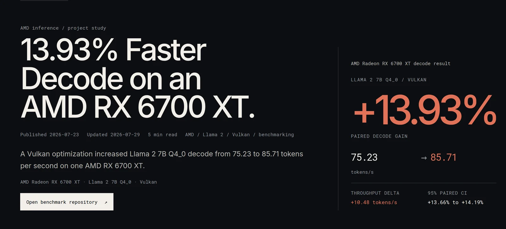
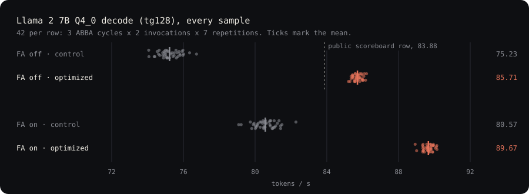
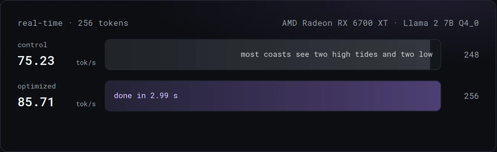
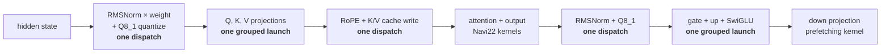

# 13.93% faster Llama 2 decode on an AMD RX 6700 XT

Vulkan kernel and graph changes to `llama.cpp` that speed up Llama 2 7B `Q4_0`
token generation on an RX 6700 XT (Navi22), measured against a matched control
with checksummed raw evidence.

**Write-up → [austxu.dev/blog/rx-6700xt-llama2-decode](https://austxu.dev/blog/rx-6700xt-llama2-decode)**
· [Project page](https://austxu.dev/work/amd-inference)

[](https://austxu.dev/work/amd-inference)

## Results

| Llama 2 7B `Q4_0`, decode (`tg128`) | Control | Optimized | Paired gain | 95% CI |
| --- | ---: | ---: | ---: | ---: |
| Flash attention off | 75.23 t/s | **85.71 t/s** | **+13.93%** | [+13.66%, +14.19%] |
| Flash attention on | 80.57 t/s | **89.67 t/s** | **+11.29%** | [+10.91%, +11.72%] |

Prompt processing (`pp512`) is unchanged: +0.004% and +0.015%, with both
intervals crossing zero. The gain is in decode, where the model runs the same
small graph once per generated token.



At 85.71 t/s, a 256-token reply finishes in 2.99 s instead of 3.40 s:

[](https://austxu.dev/work/amd-inference)

## What changed

Decode on a 7B model is dominated by matrix-vector products against quantized
weights, plus many small dispatches around them. The patches attack both.



- **Shape-specific `Q4_0 × Q8_1` kernels.** Wave64 integer-dot matrix-vector
  kernels with two output rows per workgroup, plus one-row variants for the
  shared QKV group and the 4,096 × 11,008 down projection. The down projection
  preloads the next weight block while it accumulates the current one.
- **Fused activation prep.** RMSNorm and its scale also write the `Q8_1`
  activation the next matrix-vector product reads, removing a standalone
  quantization dispatch.
- **Grouped projections.** Q, K and V share one launch, and so do the
  feed-forward gate and up projections, which write SwiGLU directly. Every
  candidate process logged 62 grouped launches covering 156 projections.
- **Fused post-QKV work.** Rotary encoding and the K/V cache writes run in one
  dispatch per layer.

Every route is opt-in by environment variable and off when unset. The
retained profile is ten patches on official `llama.cpp`
[`86d86ed4`](https://github.com/ggml-org/llama.cpp/commit/86d86ed4396b4130922f7b9af26e3d9fc11a591b);
see [`patches/`](patches).

## How it was measured

- **Matched control.** The control is the same source with identical
  benchmark pacing, so the only difference is the optimized routes.
- **ABBA design.** Three independent `A1 B1 B2 A2` cycles with seven samples
  per invocation, 84 raw samples per result row, to cancel drift and
  ordering effects.
- **Statistics.** Paired 95% hierarchical-bootstrap intervals with 100,000
  deterministic replicates.
- **Correctness gates** before any timing, comparing tokens and logits.
- **Hardware guard.** A 174 W run cap, forced fans, and a 95 °C abort. The
  peak was 94 °C, and the stock 186 W cap and automatic fan were restored
  after every invocation.

Full detail is in [Methodology](docs/METHODOLOGY.md) and
[Results](docs/RESULTS.md).

## Scope

- These are author-operated measurements on one card, from a dated
  custom-source profile. They are not an independent reproduction or a general
  AMD claim.
- The FA-off mean of 85.71 t/s is numerically above the RX 6700 XT row in the
  [`llama.cpp` Vulkan scoreboard](https://github.com/ggml-org/llama.cpp/discussions/10879)
  (83.88 t/s). That thread is for master-branch builds, so this is not a
  scoreboard entry or a record.
- A later port to current master
  ([`0cea3622`](https://github.com/ggml-org/llama.cpp/commit/0cea36222fe9bac5ebfc45716c9eef11f37046c4))
  produced byte-identical Vulkan output for control and candidate, but failed
  the predeclared CPU-versus-Vulkan accuracy gates for both. So no
  current-master timing was run, and the results above are not current-master
  numbers. See the [negative result](release/evidence/negative-results/current-master/llama2/summary.json).

More in [Limitations](docs/LIMITATIONS.md).

## Reproduce

**Verify the published numbers.** No GPU or model needed. This checks every
evidence checksum, recomputes all eight result rows and their intervals, and
byte-compares them with the tracked outputs:

```bash
scripts/linux/reproduce_public_release.sh analysis
```

**Rebuild the exact benchmarked source.** Start from the pinned official base
and apply the retained patches. The script verifies the final Git tree
`2d3add3e`, which is byte-identical to the benchmarked tree:

```bash
git clone https://github.com/ggml-org/llama.cpp.git external/llama.cpp-retained-a551
git -C external/llama.cpp-retained-a551 checkout 86d86ed4396b4130922f7b9af26e3d9fc11a591b
git -C external/llama.cpp-retained-a551 switch -c retained-a551-reproduction
scripts/apply_llamacpp_navi22_retained_a551.sh external/llama.cpp-retained-a551
```

The earlier nine-patch profile has a one-command builder,
`scripts/linux/build_public_llamacpp.sh`.

**Run it on your own hardware.** [Reproducing](docs/REPRODUCING.md) has the
build command, the exact model file and hash, the opt-in route variables, and
the required thermal guard. Report a new run as a fresh reproduction attempt.

To regenerate the samples chart above, run `python3 scripts/plot_decode_samples.py`.

## Repository map

| Path | Contents |
| --- | --- |
| [`patches/`](patches) | Checksummed `llama.cpp` patch series and upstream license notices |
| [`scripts/`](scripts) | Patch application, source build, deterministic analysis, README chart |
| [`release/evidence/`](release/evidence) | Raw samples, manifests and analysis for both accepted campaigns, plus the current-master negative |
| [`release/protocols/`](release/protocols) | Dated snapshot of the public scoreboard workload |
| [`docs/`](docs) | [Results](docs/RESULTS.md), [Methodology](docs/METHODOLOGY.md), [Reproducing](docs/REPRODUCING.md), [Limitations](docs/LIMITATIONS.md), [Model pin](docs/PUBLIC_RELEASE_MODELS.md) |

## License

Original code and docs are [MIT](LICENSE). Patch files keep upstream
`llama.cpp` copyright and license notices; see
[Third-party notices](THIRD_PARTY_NOTICES.md). Model weights are not included.
